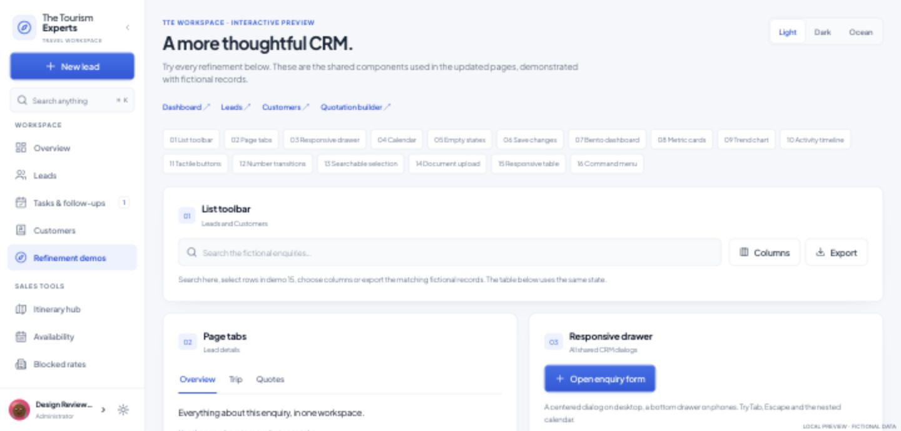
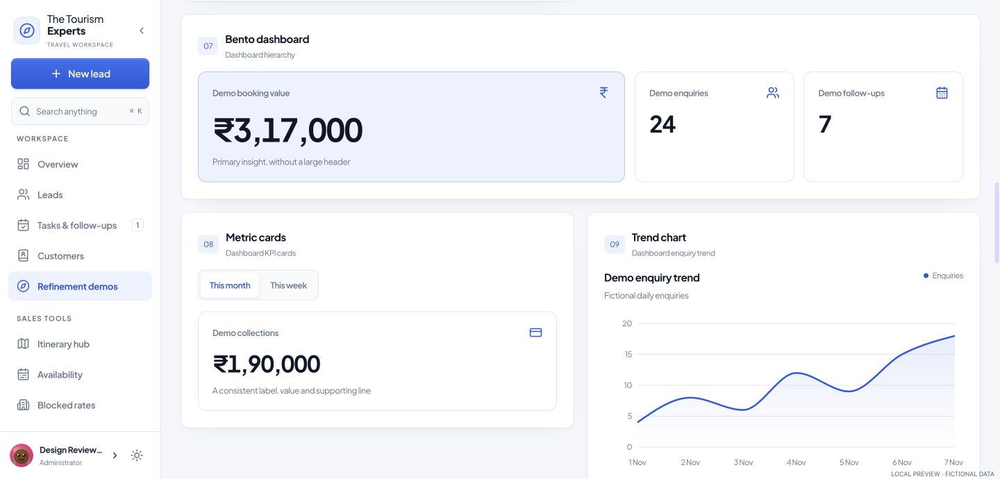
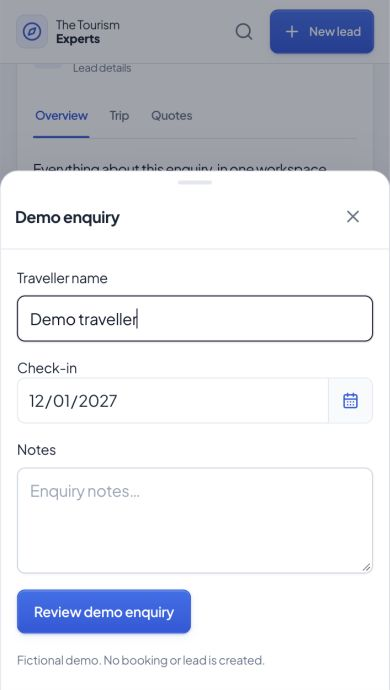

# CRM refinements and interactive demos

Implemented 4 November 2026 on `codex/crm-ui-mobile-refresh`.

## Review

The protected **`/#/ui-demo`** route contains 16 interactive examples, a section index, theme choices and links to the working CRM pages. The local fictional preview is **http://127.0.0.1:3187/#/ui-demo** (access code `preview` if prompted). `npm run build:ui-preview` builds it; `npm run preview:ui` starts the localhost-only server.

The tour demonstrates the same shared controls used by the CRM. Its save/upload actions are explicitly simulated and do not create records or transmit files. The regular local CRM preview rejects writes, so failed-save verification cannot affect real records. The demo navigation item is shown only when `VITE_UI_DEMO=true`; the route itself remains protected by the existing login requirement.

These are original adaptations of the patterns in the [21st shopping research](21st-shopping/README.md), not a bulk installation of catalog source. No full-source views, AI-generation credits or subscriptions were used; no new runtime packages were added. Existing React, Framer Motion, Recharts and React Day Picker provide the underlying behavior. The calendar loads on demand, and global search does not pull chart code into the initial application bundle.

## All 16 recommendations

| Demo | Refinement | Working CRM integration |
| --- | --- | --- |
| 01 | Compact table toolbar | Leads search/export; Customer search, columns, export and contextual selected-booking count. Customer exports use selected matching bookings when a selection exists. Filter/view changes clear selection. |
| 02 | Inner-page tabs | Lead details now have Overview, Trip details, Quotations, Payments, Activity & chat and Documents. Editing state stays in the parent when switching tabs. Filter switches use `aria-pressed`, not tab semantics. |
| 03 | Responsive dialogs | Shared Modal (including both export dialogs) remains centered on desktop and becomes a bottom drawer below 768px. Retains portal rendering, scroll containment, Escape handling, focus trap, nested-dialog handling and return focus. |
| 04 | Calendar inputs | New Lead forms, lead date filters/profile, customer booking dates, Dashboard custom dates, Rann/SOU/Rajarshi quotation builders and the lead quote calculator. Native date editing, names/validation, date-only values and existing pricing logic remain. |
| 05 | Empty/error states | Lead workspace and Payments lists; shared tables, chart fallback and activity history. Useful actions distinguish empty data, filtered-out results and errors. |
| 06 | Save/Discard feedback | Lead profile waits for the actual update. Failure retains the form and shows an error; discard restores the saved lead. Existing callers retain the prior error-handling behavior through an opt-in `throwOnError` option. Dirty forms warn on browser unload; embedded workspace navigation keeps its existing dirty-form guard. |
| 07 | Bento hierarchy | Dashboard's existing KPI grid now gives revenue more visual emphasis and width; compact supporting cards remain. The tour shows the same visual hierarchy with fictional figures. |
| 08 | Consistent metric cards | Shared MetricCard is used for customer/account totals; Dashboard retains its richer KPI content and uses the same tokens and number treatment. Unavailable totals show a dash rather than a fabricated zero. |
| 09 | Chart refinement | A real daily enquiry trend in Dashboard uses the current agent/role and selected period scope. Includes touch tooltips, integer count ticks and a text-data alternative. Existing financial/chart calculations are retained. |
| 10 | Grouped activity history | Lead Overview shows recent activity; Activity & chat shows the history grouped by day with timestamps and the existing recorded content/sentiment. The schema does not include actors, so the UI does not invent authors. |
| 11 | Tactile buttons | Shared primary Button has restrained depth and press feedback. Explicit custom-background/destructive actions retain their semantic colors. Focus and disabled states remain visible. |
| 12 | Number transitions | Shared AnimatedNumber drives Dashboard KPI changes and shared customer metrics. Starts from the actual value; animates subsequent changes and respects reduced motion. Screen readers receive the final formatted value, not every frame. |
| 13 | Searchable/async selection | Owners, Customer destination/vendor/agent filters, and payment-link customer choice. The shared control also supports debounced async loading, cancellation, error/retry, no results and keyboard selection; the tour exercises that path with simulated data. |
| 14 | Document upload | Documents tab adds category selection and drag/drop alongside a normal file chooser. Keeps the existing R2/Supabase service, 25 MB maximum and large-file confirmation. Pending state is indeterminate; success is shown only after the real upload and metadata save resolve. |
| 15 | Responsive tables | Customer and vendor accounts use a shared semantic sortable table with column visibility. On phones it becomes labelled cards; sorting is applied across all matching rows before the visible-row limit. Existing exports, balances and booking drilldowns remain. |
| 16 | Command menu | Existing workspace search now uses the shared accessible dialog, grouped leads/customers/actions, keyboard navigation, visible active state and a labelled search field. Existing navigation/theme/new-lead actions remain available. |

The [source list](21st-shopping/selections.json) maps each recommendation to its original catalog listing. Catalog listing licenses were recorded during research; no full implementation source was copied. Imported packages retain their existing licenses.

## Validation and limits

See `refinement-validation.json` for the recorded browser layout checks and interaction results. The browser checks use fictional records and Chrome viewport emulation. Physical iOS/Android keyboards, real customer messaging, live payment creation and successful live document storage are not exercised by the read-only preview.

The existing database queries, roles, R2 access model, server integrations, pricing engines and quotation PDF generation are not redesigned. The only LeadContext contract addition lets the new profile-save caller observe an existing update error. The underlying `.update(...).eq(...).select().single()` request remains the same, in line with [Supabase's update reference](https://supabase.com/docs/reference/javascript/update).

Existing repository limitations are documented in [REVIEW.md](REVIEW.md). Full TypeScript checking has 38 pre-existing diagnostics, including Deno function imports and older quoting-script types; no new diagnostics remain in the refinement components/pages. Existing large-bundle warnings remain. The pre-existing broad pricing-verifier discrepancies are outside this UI change.

This branch is prepared for review; production `main` has not been merged as part of this work.

## Screenshots

Actual fictional-preview captures, not design mockups:

